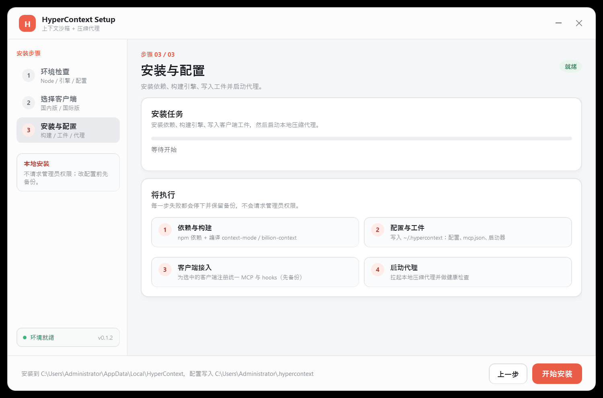

# HyperContext Mode

[](https://github.com/cv-superding/hypercontext-mode/stargazers)
[](https://nodejs.org/)
[](./LICENSE)
[](https://github.com/cv-superding/hypercontext-mode/releases/latest/download/HyperContext-Setup.exe)

> **The other half of the other half.**
> Sandboxed tool output + reversible conversation compression, in one runtime.

HyperContext Mode 把两个互补的项目合并成一个上下文操作系统：

- **[context-mode](https://github.com/mksglu/context-mode)** — 管「进入上下文的工具输出」：沙箱执行、FTS5 知识库、会话记忆、hooks 路由、MCP 工具。
- **[billion-context](https://github.com/ranxianglei/billion-context)** — 管「已经进入上下文的对话历史」：模型 API 代理、增量分层压缩、可逆解压、前缀缓存友好。

想知道到底有没有用：直接看 **[效果实测](#效果实测安装前-vs-安装后)** —— 本机跑出来的真实字节数，连失败案例一起写（自然语言提问 0/4 命中）。

合并后的 `hctx` 不是把两个 CLI 包一层，而是共享策略、存储、检索和生命周期的三层运行时：


```
┌──────────────────────────────────────────────────────────────┐
│ Client (Claude / Codex / Qoder / WorkBuddy / ... 34)         │
│   ├─ MCP: unified endpoint → ctx_* + hc_*                    │
│   ├─ Hooks: PreToolUse / SessionStart / PreCompact           │
│   └─ Model traffic: base URL / launcher / native plugin      │
└───────────────┬───────────────────────────┬──────────────────┘
                │                           │
        ┌───────▼────────┐          ┌───────▼──────────────┐
        │ Sandbox layer  │          │ Compression layer    │
        │ context-mode   │          │ billion-context      │
        │ - executor     │          │ - API proxy          │
        │ - FTS5 memory  │          │ - ACP summaries      │
        │ - session DB   │          │ - decompress/search  │
        └───────┬────────┘          └───────┬──────────────┘
                │                           │
        ┌───────▼───────────────────────────▼──────────────┐
        │ Control plane: policy · config · federation       │
        │ ~/.hypercontext/{config.json,data,state,logs}     │
        │ hc_search · hc_status · hc_doctor · hctx CLI      │
        └───────────────────────────────────────────────────┘
```

---

## Windows 一键安装器（推荐小白）

[下载 HyperContext-Setup.exe](https://github.com/cv-superding/hypercontext-mode/releases/latest/download/HyperContext-Setup.exe) · [安装器源码](installer/)

原生 WPF，支持 Windows 10/11，**不需要管理员权限**，不是 Electron。界面按「国际版 / 国内版」分组：

| 国际版 | 国内版 |
|---|---|
| Claude Code | Qoder 国内版 |
| Codex CLI | WorkBuddy 国内版 |
| Qoder 国际版 | DeepSeek Harness (dsh) |
| WorkBuddy 国际版 | Zcode (Z.ai) |




安装器会：

1. 检测 Node.js 22.18+；没有就自动下载便携 Node 24。
2. 如果本机没有项目，自动下载 GitHub 源码到 `%LOCALAPPDATA%\HyperContext\app`。
3. 安装依赖并构建 context-mode / billion-context。
4. 初始化 `~/.hypercontext`。
5. 为选中的客户端生成 MCP / 启动器工件；只对**检测到**的客户端安装 hooks 或原生插件，并在修改前备份。
6. 启动本地压缩代理，运行 `hctx doctor` 和 `hctx status`。

安装成功后安装器会记录状态（`~/.hypercontext/state/installer.state`）。再次打开时若检测到已安装，第三步会直接给出**完成并关闭**，不会强迫你重装；需要重建环境时再点**重新安装 / 修复**。

第一步只列出真正需要的操作：四项全绿时只剩**重新检查**（会给出检查结果和时间），缺 Node 或缺源码时才出现**下载 Node 24**、**下载项目**、**选择已有源码目录…**；需要补环境时才出现**修复运行环境**。

> Qoder / WorkBuddy 的客户端 MCP 配置仍需在客户端里手动添加；安装器会生成对应的 `mcp.json` 并在日志里打印路径。Qoder 的压缩层用 `hctx launch qoder` 启动。

如果你更喜欢手动安装，继续看下面的章节。

## 目录

- [Windows 一键安装器](#windows-一键安装器推荐小白)
- [它解决什么问题](#它解决什么问题)
- [效果实测（安装前 vs 安装后）](#效果实测安装前-vs-安装后)
- [功能总览](#功能总览)
- [快速开始](#快速开始)
- [安装](#安装)
- [客户端接入](#客户端接入)
- [日常使用](#日常使用)
- [统一 MCP 工具](#统一-mcp-工具)
- [配置](#配置)
- [数据目录与隐私](#数据目录与隐私)
- [故障排查](#故障排查)
- [架构](#架构)
- [与上游的关系](#与上游的关系)
- [开发与测试](#开发与测试)
- [卸载](#卸载)
- [许可证](#许可证)
- [路线图](#路线图)

---

## 它解决什么问题

一次 MCP 工具调用会把原始数据直接灌进上下文：一个网页快照、20 个 GitHub issue、一份访问日志，可能瞬间吃掉几十 KB。与此同时，长会话的历史会不断膨胀，最终触发宿主压缩，模型忘掉正在改的文件、任务和用户刚才的要求。

两个上游分别解决了一半：

| 问题 | 谁来解决 | 合并后的行为 |
|---|---|---|
| 工具输出太大 | context-mode | `ctx_*` 沙箱执行，只把结果放回上下文 |
| 网页/命令/文件内容需要反复查 | context-mode | FTS5 索引 + BM25/trigram 检索 |
| 压缩后忘记上下文 | context-mode | SQLite 会话事件 + 可检索记忆 |
| 对话历史无限增长 | billion-context | API 代理 + 增量分层压缩 + 可逆解压 |
| 长会话跨天/跨周 | billion-context | 单会话可承载数十亿 token |
| 两套工具/存储/安装器打架 | **本项目的控制面** | 统一 MCP、统一搜索、统一状态、统一策略 |

## 效果实测（安装前 vs 安装后）

下面每个数字都是在本机（Windows 10 + Node 24）跑真实代码得到的，一条命令复现：

```bash
node tools/bench-effect.mjs --json docs/bench/effect.json
```

### 场景：从一份 68,567 B 的源文件里找回 4 个确切标识符

| 做法 | 模型侧要吃的字节 | vs 每次都读全文 |
|---|---:|---:|
| 每次都把整份文件读进上下文 | 274,268 B | — |
| 读一次全文，之后每次 grep（保守基线） | 69,649 B | −75% |
| 索引一次 + `ctx_search` 逐个找回 | 3,878 B | **−98.6%** |

这条路径**不是白拿的**：4 个标识符里 `hypercontext-uninstall.bak` 没检索到（分词把点号切开了）。所以沙箱检索不能当成 grep 的直接替身——命中后要核对，没命中就退回 grep / 直读。

### 它擅长什么、不擅长什么（同一脚本实测命中率）

| 查询类型 | 例子 | 命中 |
|---|---|---:|
| 确切标识符 | `RefreshClientBadges`、`installer.state`、`EnsureCodexMcp` | 3 / 4 |
| 自然语言提问 | "卸载时备份文件叫什么名字"、"谁来负责启动压缩代理" | **0 / 4** |

`ctx_search` 是 **BM25 + trigram 关键词检索，不是问答引擎**。要答案，要么自己给准检索词，要么用 `ctx_execute` 让代码替你算。

### 大文件读取会被拦吗？

不会。读 68,567 B 的文件时，hook 只在**本会话第一次**注入 487 B 引导（提示改用 `ctx_execute_file`），读取本身照常放行。默认 `balanced` 和 `advisory` 都不拦；只有 `strict` 才对 WebFetch / curl 这类外部抓取做硬重定向。

### 压缩层到底省了多少？

**这台机器上测不出来，我们就不编数字。** 压缩率取决于模型自己写的摘要和真实流量，只有正常用一段时间才有意义。看实时数据：

```bash
hctx stats     # returned / avoided 字节、tokensSaved、hitPct、压缩块数
hctx status    # 代理健康度 + 概览
```

`avoided` 是 hook 逐次记账的真实字节数，不是估算。

### 有一项优化这次没测出差异

`HYPERCONTEXT_MEMORY_INJECTION=minimal`（会话恢复时只给一行提示、不灌整份快照）在本机两种模式下都是 4,968 B——因为这里没有真实客户端会话可恢复，快照本身是空的。要看到差异，需要在 Claude Code / Gemini CLI 里跑足够长的会话并触发一次压缩。

### 在 Qoder 里做的真 A/B（同一任务，四种配置）

任务：只依据 `installer/HyperContextSetup.cs`（1758 行 / 68,567 B）回答 6 个代码问题。每种配置各开一个全新 Qoder 会话，互不共享历史。

| 组 | 配置 | 实际工具序列 | 进入上下文的字节 | 答案正确率 |
|---|---|---|---|---|
| A | 未接入 | `Bash×1 + Read×2`（全文）`+ Grep×1` | ≥ 68.6 KB 正文（另有 Read 行号前缀约 12 KB） | 5/6 + 1 题正确拒答 |
| B | 只挂 MCP，不引导 | `Read×1`（全文） | ≥ 68.6 KB | 5/6 + 1 题正确拒答 |
| C | 挂 MCP + 引导（修复前） | `mcp_call` 失败 → `Grep×17 + Read×3` | 与 A 同量级 | 5/6 + 1 题正确拒答 |
| D | 挂 MCP + 引导（修复后） | `ctx_execute_file×8 + ctx_stats×1` | **29.2 KB**（`ctx_stats` 原文） | 5/6 + 1 题正确拒答 |

四个结论都是数据给的，不是推测：

1. **正确率一模一样**（都是 5/6；第 6 题的答案确实不在该文件里，四组都正确地回答了"找不到"）。沙箱不提升答案质量，它只搬运字节。
2. **只挂 MCP 不会自动生效**：B 组一次 `ctx_*` 都没调用。Qoder 的 MCP 工具是懒加载的，模型不会主动去够——省字节必须靠引导（hooks 或显式指令）。
3. **D 组省约 57%**（68.6 KB → 29.2 KB），代价是工具调用从 4 次涨到 11 次。这是**拿往返次数换上下文空间**：长会话里划算，一次性小任务里不划算。
4. C 组顺带暴露了一个真 bug，见下。

### C 组的 bug：桌面宿主下沙箱读不到工作区

Qoder 从自己的安装目录（本机是 `D:\user\software\Qoder CN`）启动 MCP 子进程，而我们的控制面又用 `process.cwd()` 覆盖了 `CONTEXT_MODE_PROJECT_DIR`，于是 context-mode 的工作区包含策略把仓库里的每个文件都判成"工作区之外"：

```
File access blocked: "E:\...\installer\HyperContextSetup.cs" resolves outside the project root (D:\user\software\Qoder CN).
```

已修复：新增 `resolveWorkspaceDir()`，显式声明的 `CONTEXT_MODE_PROJECT_DIR` 优先于启动 cwd（`packages/runtime/src/engines.ts`），CLI 也不再伪造显式值；`tests/workspace-dir.test.ts` 钉住这个优先级。

**Qoder / WorkBuddy 用户还要手动一步**：在 MCP 配置里写 `"CONTEXT_MODE_PROJECT_DIR": "<项目绝对路径>"` 并重载该服务，否则沙箱工具会像 C 组一样被拒。

```json
{
  "mcpServers": {
    "hypercontext": {
      "command": "…\\node.exe",
      "args": ["…\\bin\\hctx.mjs", "mcp", "--client", "qoder-cn"],
      "env": {
        "HYPERCONTEXT_HOME": "C:\\Users\\你\\.hypercontext",
        "CONTEXT_MODE_PROJECT_DIR": "E:\\code\\你的项目"
      }
    }
  }
}
```

安装器生成的 `mcp.json` 里**没有**自动写死这个路径：Qoder 的 MCP 配置是用户级的，钉死单个仓库会让多项目场景出错。

## 功能总览

### 已实现

- **统一 MCP 端点**：11 个 `ctx_*` + 3 个 `hc_*`，一次接入两层能力。
- **统一联邦搜索**：`hc_search` / `hctx search` 同时检索：
  - 已索引的工具/网页/文件内容（FTS5）
  - 会话事件、决策、错误（SQLite）
  - 压缩摘要与压缩前的原始消息（billion-context `index.db`）
- **代理侧联邦搜索**：`search_context` 在统一运行时下也会追加沙箱 FTS5 命中。
- **统一状态**：`hctx status` / `hc_status` 同时显示沙箱节省、压缩块、代理请求、缓存命中率。
- **统一体检**：`hctx doctor` / `hc_doctor` 检查 Node、引擎构建、代理、存储、更新通道和策略冲突。
- **34 客户端能力矩阵**：native plugin、launcher、MCP、proxy fallback 一目了然；Qoder / WorkBuddy 的国内版与国际版分开管理。
- **自动 hooks**：Claude Code、Gemini CLI、Qwen Code 已验证全 6 事件安装（安装前备份、可重复安装）。
- **三档路由**：`strict` / `balanced`（默认）/ `advisory`，不再无脑硬拦 WebFetch。
- **双压缩协调**：压缩代理启用时，会话记忆只注入最小提示，快照仍入库可搜。
- **自更新默认关闭**：不会在后台悄悄覆盖 vendored 引擎。
- **统一存储根**：配置、会话、CA、日志、缓存全部收进 `~/.hypercontext`。
- **优雅启停**：启动探测端口冲突；停止走代理的 flush 流程，外部代理不误杀。

### 当前边界

- 自动 hooks 安装首版只开放 **Claude Code / Gemini CLI / Qwen Code**；其余客户端通过统一 MCP + 压缩代理覆盖，不会贸然写配置。
- Qoder / TRAE / CodeBuddy 走 billion-context 的 launcher（证书 MITM）路径，MCP 工件已生成；Qoder 尚未做真实端到端启动验证。
- Windows 安装器已覆盖 Codex、Claude、WorkBuddy 国内/国际、Qoder 国内/国际、DeepSeek Harness、Zcode；Qoder/WorkBuddy 的 MCP 需要在客户端里手动接入。
- 统一 session identity（host session ↔ 沙箱事件 ↔ 压缩会话）仍在路线图中。
- 代理侧沙箱检索暂未按项目过滤，使用跨项目去重。
- 本项目尚未发布到 npm；当前以源码仓库方式使用。

## 快速开始

要求：**Node.js >= 22.18**（直接运行 TypeScript）或 Node 24 LTS。

```bash
git clone https://github.com/cv-superding/hypercontext-mode.git
cd hypercontext-mode

npm install
npm run setup:engines       # 安装两个引擎的依赖
npm run build:engines       # 构建 context-mode + billion-context

node bin/hctx.mjs init      # 创建 ~/.hypercontext
node bin/hctx.mjs setup --all
node bin/hctx.mjs start     # 启动压缩代理
node bin/hctx.mjs doctor    # 全部检查应通过
```

Windows 下可以用 `bin\hctx.cmd`，Git Bash 下用 `bin/hctx`：

```bat
bin\hctx.cmd init
bin\hctx.cmd setup --all
bin\hctx.cmd start
bin\hctx.cmd status
```

启动客户端：

```bat
bin\hctx.cmd launch claude-code
bin\hctx.cmd launch codex
bin\hctx.cmd launch qoder
```

## 安装

### 1. 前置条件

- **Node.js >= 22.18**（推荐 24 LTS）。本项目直接运行 TypeScript，依赖 Node 的类型剥离能力。
- **npm >= 10**（随 Node 分发）。
- **git**（拉取仓库；部分引擎功能也会调用 git）。
- 首次构建需要网络访问 npm registry。
- Windows / macOS / Linux 均可。Windows 建议 PowerShell 或 Git Bash。

检查版本：

```bash
node -v
npm -v
```

### 2. 拉取并安装

```bash
git clone https://github.com/cv-superding/hypercontext-mode.git
cd hypercontext-mode
npm install
npm run setup:engines
npm run build:engines
```

`setup:engines` 会在 `engines/` 下分别安装两个上游引擎的依赖；`build:engines` 会构建 context-mode 的服务端/CLI/hooks 和 billion-context 的代理/插件 bundle。

> 依赖安装默认带 `--ignore-scripts`，避免上游 postinstall 在你不知情时修改客户端配置。控制面全部使用 Node 内置 `node:sqlite`，不依赖原生 SQLite 编译。

> 如果只想先体验，不安装依赖也可以运行控制面命令（`hctx init`、`hctx clients`、`hctx config`），但 `start`、`index`、MCP 沙箱工具需要先完成引擎构建。

### 3. 可选：安装全局 `hctx`

```bash
npm link
hctx --help
```

`npm link` 会在 npm 全局 bin 目录创建一个 `hctx` 软链。若提示找不到命令，把 npm 全局 bin 目录加入 PATH：

- Windows：`%APPDATA%\npm`
- macOS/Linux：通常是 `/usr/local/bin` 或 `~/.local/bin`

也可以不安装全局命令，直接使用：

```bash
node bin/hctx.mjs <command>
```

### 4. 初始化

```bash
hctx init
```

这会创建：

```
~/.hypercontext/
  config.json
  data/
  state/
  bin/
```

自定义位置：

```bash
HYPERCONTEXT_HOME=/path/to/home hctx init
```

所有命令和生成的客户端工件都会记住该路径。

### 5. 验证安装

```bash
hctx doctor
hctx status
```

`doctor` 的期望结果：

```
[ok] Node.js
[ok] Unified config
[ok] Engines
[ok] Update channels
[ok] Storage
[ok] Store integrity
[ok] Compression proxy
```

如果代理尚未启动，会显示一条 `warn`，执行 `hctx start` 即可。

## 客户端接入

### 1. 生成工件（所有客户端）

```bash
hctx setup --all
```

会为 34 个客户端生成：

- 统一 MCP 配置片段：`~/.hypercontext/state/clients/<client>/mcp.json`
- 一键启动器：`~/.hypercontext/bin/<client>.cmd` 和 `<client>.sh`

这一步**不会**修改任何客户端配置。

### 2. 查看能力矩阵

```bash
hctx clients
```

每一行显示：

```
client               hooks   mcp   compression    label
claude-code          yes     yes   plugin:claude  Claude Code
qoder-intl           -       yes   launcher:qoder Qoder 国际版
qoder-cn             -       yes   launcher:qoder Qoder 国内版
workbuddy-intl       -       yes   proxy-only     WorkBuddy 国际版
workbuddy-cn         -       yes   proxy-only     WorkBuddy 国内版
```

- `hooks`：是否支持自动 hook 路由。
- `mcp`：是否可接入统一 MCP。
- `compression`：走 native plugin、launcher，还是只能手动指向代理。

### 3. Claude Code（推荐完整接入）

```bash
hctx setup claude-code --hooks
```

会：

- 把统一 MCP 配置写到 `~/.hypercontext/state/clients/claude-code/mcp.json`
- 在 `~/.claude/settings.json` 安装 PreToolUse、PostToolUse、PreCompact、UserPromptSubmit、SessionStart、Stop 六个 hooks
- 修改前自动备份为 `settings.json.bak`
- 所有 hook 命令都指向统一的 `hook-wrapper`，并内嵌 `HYPERCONTEXT_HOME`

手动把 MCP 片段合并进你的 Claude Code 配置，或使用上游插件机制指向：

```json
{
  "mcpServers": {
    "hypercontext": {
      "command": "node",
      "args": ["<repo>/bin/hctx.mjs", "mcp", "--client", "claude-code"],
      "env": { "HYPERCONTEXT_HOME": "<home>/.hypercontext" }
    }
  }
}
```

### 4. Gemini CLI / Qwen Code

```bash
hctx setup gemini-cli --hooks
hctx setup qwen-code --hooks
```

同样会安装全 6 事件并备份设置。写入位置分别是 Gemini / Qwen 的 `settings.json`。

### 5. Codex CLI

```bash
hctx setup codex --plugin
```

或者直接使用启动器：

```bash
hctx launch codex
```

Codex 的 MCP 片段同样在 `~/.hypercontext/state/clients/codex/mcp.json`。

### 6. Qoder 国内版 / 国际版、WorkBuddy、TRAE、CodeBuddy

Qoder 两个版本共用 billion-context 的 launcher（证书 MITM），但工件分开生成：

```bash
hctx setup qoder-cn
hctx setup qoder-intl
hctx launch qoder
```

WorkBuddy 通过统一 MCP + 本地代理 base URL 接入：

```bash
hctx setup workbuddy-cn
hctx setup workbuddy-intl
```

TRAE / CodeBuddy：

```bash
hctx launch trae
hctx launch codebuddy
```

沙箱层使用统一 MCP，片段在：

```
~/.hypercontext/state/clients/qoder-intl/mcp.json
~/.hypercontext/state/clients/qoder-cn/mcp.json
~/.hypercontext/state/clients/workbuddy-intl/mcp.json
~/.hypercontext/state/clients/workbuddy-cn/mcp.json
```

把对应片段加入客户端的 MCP 配置即可。首次使用证书 MITM 时，客户端/系统可能要求信任本地 CA；按 launcher 的提示操作。

> Qoder 的 launcher 路径已接好，但当前版本尚未在真实 Qoder 安装上做端到端验证。WorkBuddy 需要手动把生成的 MCP 工件加入客户端配置，并把模型 base URL 指向本地代理。遇到问题请先运行 `hctx doctor` 并附上 `~/.hypercontext/state/logs/proxy.log`。

### 7. 其他客户端

- 有 launcher 的客户端：`hctx launch <client>`。
- 只有 MCP 的客户端：把 `~/.hypercontext/state/clients/<client>/mcp.json` 合并进客户端配置。
- 只能配置 base URL 的客户端：`hctx start` 后，把模型 API base URL 指向：

```
http://127.0.0.1:8787/bili/<上游完整 URL>
```

或使用客户端自己的代理设置指向 `127.0.0.1:8787`。

## 日常使用

### 启动 / 停止 / 状态

```bash
hctx start                # 后台启动压缩代理
hctx start --foreground   # 前台运行，便于调试
hctx start --restart      # 重启
hctx stop                 # 优雅停止（不杀外部代理）
hctx status               # 统一状态
hctx status --json        # 机器可读
```

### 索引内容

```bash
hctx index ./src                 # 索引目录
hctx index ./docs/a.md           # 索引单个文件
hctx index https://...           # 由 context-mode 的抓取工具处理
```

索引时注意项目根：

```bash
hctx index ./notes.md --project "$PWD"
```

`--project` 决定内容库属于哪个项目；MCP 会话默认使用当前工作目录作为项目根。两者一致时，`ctx_search` 和 `hc_search` 才能命中同一份内容。

### 搜索

```bash
hctx search "refresh token"
hctx search "retry race" --scope sandbox
hctx search "compression" --scope compression
hctx search "needle" --all-projects
hctx search "needle" --json
```

默认只搜当前项目；`--all-projects` 放宽到所有项目库。

### 统计

```bash
hctx stats
hctx stats --json
```

输出包括沙箱返回/避免字节、估算节省 token、压缩块数、压缩 token、代理请求与缓存命中率。

### 客户端启动

```bash
hctx launch claude-code
hctx launch codex
hctx launch qoder
hctx launch opencode
```

也可以直接运行生成的启动器：

```
~/.hypercontext/bin/claude-code.cmd
~/.hypercontext/bin/qoder.cmd
```

### 配置

```bash
hctx config path                       # 配置文件路径
hctx config show                       # 当前配置
hctx config set compression.port 9000
hctx config set sandbox.routing advisory
hctx config set sandbox.memoryInjection auto
```

## 统一 MCP 工具

在 context-mode 的 11 个工具之外，新增：

| 工具 | 作用 |
|---|---|
| `hc_search` | 一次检索沙箱索引、会话事件、压缩摘要和原始消息 |
| `hc_status` | 统一健康、策略、节省、代理账本 |
| `hc_doctor` | 统一诊断 |

`hc_search` 参数：

```json
{
  "query": "refresh token",
  "scope": "all",
  "limit": 10,
  "all_projects": false
}
```

结果会标注：

- `[sandbox/content]`：FTS5 索引内容
- `[sandbox/session-event]`：会话事件/决策
- `[compression/compression-summary]`：压缩摘要（带 `ref`，可用于 `decompress`）
- `[compression/compression-message]`：压缩前原始消息

沙箱子进程不可用时，`hc_*` 仍然可用；`ctx_*` 会返回明确的修复提示，不会拖垮整个 MCP。

### 手动 MCP 配置（通用）

```json
{
  "mcpServers": {
    "hypercontext": {
      "command": "node",
      "args": ["/absolute/path/to/hypercontext-mode/bin/hctx.mjs", "mcp", "--client", "your-client"],
      "env": { "HYPERCONTEXT_HOME": "/home/you/.hypercontext" }
    }
  }
}
```

## 配置

默认配置 `~/.hypercontext/config.json`：

```json
{
  "version": 1,
  "profile": "balanced",
  "sandbox": {
    "enabled": true,
    "routing": "balanced",
    "memoryInjection": "auto",
    "autoIndexSessionEvents": true
  },
  "compression": {
    "enabled": true,
    "host": "127.0.0.1",
    "port": 8787,
    "autoUpdate": false,
    "advisoryCheck": false,
    "releaseNotesCheck": false
  },
  "memory": { "retentionDays": 30 },
  "clients": {},
  "update": { "auto": false },
  "telemetry": { "enabled": false }
}
```

### 字段说明

| 字段 | 取值 | 说明 |
|---|---|---|
| `profile` | `balanced` / `lean` / `maximum` | 预设档位（当前主要用于初始化） |
| `sandbox.enabled` | boolean | 是否启用沙箱层 |
| `sandbox.routing` | `strict` / `balanced` / `advisory` | 工具路由严格度 |
| `sandbox.memoryInjection` | `auto` / `full` / `minimal` | 压缩开启时 `auto` = minimal |
| `compression.enabled` | boolean | 是否启用压缩代理 |
| `compression.host` / `port` | string / number | 代理监听地址，默认仅 loopback |
| `compression.autoUpdate` | boolean | 在统一运行时被忽略，始终关闭 |
| `update.auto` | boolean | 同上 |
| `clients.<id>.sandbox` | boolean | 客户端级沙箱开关 |
| `clients.<id>.compression` | boolean | 客户端级压缩开关 |

### 路由模式

| 模式 | WebFetch | curl/wget | inline HTTP | build 日志 |
|---|---|---|---|---|
| `strict` | 拒绝并重定向 | 重定向到沙箱 | 重定向到沙箱 | 重定向到沙箱 |
| `balanced` | 放行 + 一次提示 | 重定向到沙箱 | 重定向到沙箱 | 重定向到沙箱 |
| `advisory` | 放行 | 放行 | 放行 | 放行 |

### 环境变量

| 变量 | 作用 |
|---|---|
| `HYPERCONTEXT_HOME` | 整体数据根，默认 `~/.hypercontext` |
| `HYPERCONTEXT_ROUTING_MODE` | 覆盖路由模式（hooks 使用） |
| `HYPERCONTEXT_MEMORY_INJECTION` | 覆盖记忆注入模式 |
| `CONTEXT_MODE_DIR` | context-mode 存储根（由 hctx 自动设置） |
| `ACP_AUTO_UPDATE` | billion-context 自更新（hctx 固定为 0） |
| `BILI_ADVISORY_CHECK` | 安全公告检查（hctx 固定为 0） |
| `BILI_RELEASE_NOTES_CHECK` | 版本公告检查（hctx 固定为 0） |

一般不需要手动设置；`hctx` 会把统一环境传给两个引擎。

## 数据目录与隐私

```
~/.hypercontext/
  config.json
  data/
    context-mode/
      sessions/<projectHash>.db       # 会话事件/快照
      content/<projectHash>.db        # FTS5 知识库
    compression/
      config.json                     # 合并受管更新字段
      sessions/index.db               # 压缩摘要/消息/块
    xdg/billion-context/ca/           # 按需生成的 MITM CA
  state/
    daemon.json
    logs/proxy.log
    logs/mcp-child.log
    clients/<id>/mcp.json
  bin/<client>.cmd|.sh
```

- 默认不启用遥测。
- 代理默认绑定 `127.0.0.1`，管理端点仅 loopback。
- 若绑定非 loopback 地址，`hctx status` / `doctor` 会明确警告：代理没有认证。
- hooks / 客户端配置只在显式 `--apply` / `--hooks` / `--plugin` 时修改，并在修改前备份。
- 会话数据保留期由 context-mode / billion-context 各自策略控制；彻底清理可删除 `~/.hypercontext`（会丢历史，先备份）。

## 故障排查

### `Engine build missing`

```bash
npm run setup:engines
npm run build:engines
```

### 代理启动失败或端口被占用

```bash
hctx status
hctx doctor
```

换端口：

```bash
hctx config set compression.port 9000
hctx start --restart
```

若端口上已经有健康的 billion-context 代理，`hctx` 会把它识别为 `external` 并复用；`hctx stop` 不会杀外部代理。

### `hctx` 命令找不到

- 使用 `node bin/hctx.mjs ...` 或 `bin/hctx.cmd ...`。
- 或执行 `npm link` 并把 npm 全局 bin 加入 PATH。

### Node 版本过低

本项目需要 Node >= 22.18。升级 Node 后重新执行 `npm install` 与控制面命令即可。

### hooks 没生效

- 只有 Claude Code / Gemini / Qwen 支持自动 hooks。
- 检查 `hctx setup <client> --hooks` 的输出与备份文件。
- 检查客户端设置里的 hook 命令是否指向 `packages/runtime/src/hook-wrapper.ts`。
- 运行一次 hook 命令，确认退出码为 0；wrapper 设计为 fail-open，不会阻塞宿主。

### Qoder / 证书 MITM

- 首次使用 launcher 可能需要信任本地 CA。
- 如果客户端不认代理，先运行 `hctx doctor`，再查看 `~/.hypercontext/state/logs/proxy.log`。
- 也可只使用统一 MCP（沙箱层），压缩层稍后再接。

### 搜索没有结果

- 确认索引时的 `--project` 与 MCP 会话的当前工作目录一致。
- 先 `hctx search ... --all-projects` 排除项目作用域问题。
- 中文/短词查询会走 trigram/LIKE 回退；极短查询可能无结果。

### SQLite 相关错误

- 本项目优先使用 Node 内置 `node:sqlite`，不需要原生编译。
- 如果看到锁/损坏提示，`hctx doctor` 会列出无法读取的库；备份后移走对应 `.db` 文件即可重建。

## 架构

详见 [docs/ARCHITECTURE.md](docs/ARCHITECTURE.md)。核心设计：

- **入站沙箱层**：工具输出不进上下文，索引后可检索。
- **历史压缩层**：代理在模型请求前折叠历史，模型可 `decompress` 恢复。
- **控制面**：统一配置/策略/存储/搜索/状态/安装器。
- **统一 MCP**：本进程提供 `hc_*`，把 `ctx_*` 转发给 context-mode 子进程。
- **冲突解决**：压缩开启时最小记忆注入、单一工具面、单一更新通道、单一存储根。

## 与上游的关系

- `engines/context-mode`：vendored 源码 + 3 个最小补丁（路由模式、最小记忆注入、关闭版本检查）。
- `engines/billion-context`：vendored 源码 + 1 个新增桥接模块和 1 处输出追加（`HYPERCONTEXT=1` 时启用）。
- 上游 commit、补丁清单、同步流程见 [docs/UPSTREAM.md](docs/UPSTREAM.md)。
- 许可证与归属见 [NOTICE.md](NOTICE.md) 和 [LICENSE](LICENSE)。

## 开发与测试

```bash
npm run typecheck      # 控制面类型检查
npm test               # 联邦搜索/策略/路由/CLI/桥接测试
npm run build:engines  # 重建两个引擎
```

端到端冒烟（需要先构建引擎）：

```bash
export HYPERCONTEXT_HOME="$PWD/.tmp-home"
node bin/hctx.mjs init
node bin/hctx.mjs start
node tests/mcp-smoke.mjs
node bin/hctx.mjs stop
```

测试全部使用临时目录；不会修改真实客户端配置。

效果基准（README「效果实测」一节的所有数字都出自这条命令，同样只用临时目录）：

```bash
node tools/bench-effect.mjs --json docs/bench/effect.json
```

## 卸载

### 用安装器（推荐）

打开 `HyperContext-Setup.exe`，第三步会显示「检测到本机已安装」，点 **卸载 / 还原客户端配置**：先在日志里打印卸载计划，确认后再执行。

### 用命令行

```bash
hctx uninstall                     # 只打印计划，不动任何文件
hctx uninstall --yes               # 执行卸载
hctx uninstall --keep-data --yes   # 保留 ~/.hypercontext 数据，只回滚配置
hctx uninstall --json              # 机器可读
```

它会做四件事：

1. 按 `state/daemon.json` 优雅停止本地压缩代理。
2. 从 Claude Code / Gemini CLI / Qwen Code 的 `settings.json` 里**只摘掉 hypercontext 自己的 hook 条目**（按命令特征识别，你手动加的 hooks 原样保留；事件被清空后整条删除），改前写 `settings.json.hypercontext-uninstall.bak`。
3. 删除 Codex `config.toml` 里的 `[mcp_servers.hypercontext]` 段，其余段落不动，同样先备份。
4. 删除 `~/.hypercontext`（配置、会话记忆、压缩索引、启动器工件）和 `%LOCALAPPDATA%\HyperContext`（安装器下载的便携 Node / 源码副本 / 日志）。

**不会自动处理**的两类：Qoder / WorkBuddy / DeepSeek Harness 里由你手动添加的 MCP 条目（要在各客户端自己的设置中删除），以及源码仓库目录本身（`rm -rf` 即可；`npm link` 过就先 `npm unlink -g hypercontext-mode`）。

卸载后想再用：直接重跑安装器，或 `hctx setup --all --apply`。

## 许可证

本项目是合并作品：

- `engines/context-mode`：Elastic License 2.0（ELv2），Copyright 2026 Mert Koseoğlu。
- `engines/billion-context`：MIT + 上游“产品署名”附加条款，Copyright (c) 2026 ranxianglei。
- 新增控制面代码：按 ELv2 分发，以匹配合并作品。

**合并作品整体不是 MIT**。ELv2 适用于本仓库的重要部分：不得把本软件作为托管/管理服务向第三方提供其大部分功能，必须保留版权与许可证声明。详见 [LICENSE](LICENSE)、[NOTICE.md](NOTICE.md) 与 `LICENSES/`。

本地和内部使用是当前版本的目标场景；对外发布、托管服务或商业分发前请做单独的许可证审查。

## 路线图

- 统一 session identity：host session id ↔ 沙箱事件 ↔ 压缩会话。
- 自动 hooks 扩展到 Cursor、Copilot 系、Zed、Kiro、Antigravity、Kimi、OpenClaw。
- 代理侧沙箱检索按项目过滤。
- 压缩摘要携带沙箱引用（summary → `ctx://` 句柄）。
- Qoder / TRAE / CodeBuddy 原生插件适配。
- MCP HTTP transport 与多客户端复用。
- 合并回归矩阵（双引擎测试集）。

## 致谢

- [mksglu/context-mode](https://github.com/mksglu/context-mode)
- [ranxianglei/billion-context](https://github.com/ranxianglei/billion-context)

如果这个项目帮你省下了上下文和 token，欢迎 Star、提 Issue 或 PR。
