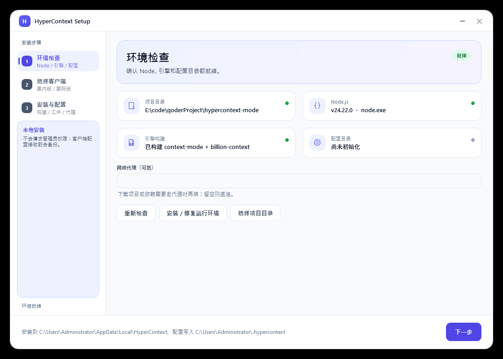
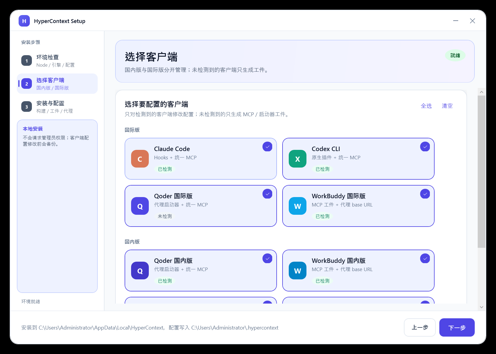

# HyperContext Setup (Windows 10/11)

A small native WPF installer/configurator for HyperContext Mode. No Electron, no
admin rights, no bundled runtime — it uses the .NET Framework 4.8 that ships
with Windows 10/11.





## Download

Get `HyperContext-Setup.exe` from the latest GitHub Release:

```
https://github.com/cv-superding/hypercontext-mode/releases/latest/download/HyperContext-Setup.exe
```

The exe is also committed at `installer/HyperContext-Setup.exe` for convenience.

## What it does

1. Detects the project directory (next to the exe, a parent directory, or
   `%LOCALAPPDATA%\HyperContext\app`).
2. Detects Node.js >= 22.18. If missing, downloads the portable Node 24 zip.
3. If the project is missing, downloads the GitHub source zip and extracts it to
   `%LOCALAPPDATA%\HyperContext\app`.
4. Runs `npm install` and the engine setup/build when needed.
5. Runs `hctx init` against `%USERPROFILE%\.hypercontext`.
6. Configures the selected clients:
   - **International:** Claude Code, Codex CLI, Qoder International, WorkBuddy International
   - **Domestic:** Qoder China, WorkBuddy China, DeepSeek Harness (dsh), Zcode
7. Starts the local compression proxy (`hctx start`).
8. Runs `hctx doctor` and shows the unified status.

## Safety

- Host configs are only modified for clients detected on disk.
- Claude Code / Codex / dsh / zcode plugin or hook writes are done by the
  upstream adapters, which back up the original settings first.
- Qoder and WorkBuddy only get generated MCP/launcher artifacts; their own
  config is not touched.
- The installer does not request administrator rights.
- All state stays under `%LOCALAPPDATA%\HyperContext` and
  `%USERPROFILE%\.hypercontext`.

## Manual next steps

- **Claude Code:** hooks are installed automatically; add the generated
  `mcp.json` to Claude Code's MCP settings (or use the `/mcp` command).
- **Codex:** the native plugin and a `[mcp_servers.hypercontext]` block are
  written to `~/.codex/config.toml` when Codex is detected.
- **Qoder:** run `hctx launch qoder` (or the generated
  `~/.hypercontext/bin/qoder-intl.cmd` / `qoder-cn.cmd`) to start it through the
  compression proxy. Connect the MCP artifact in Qoder's MCP settings.
- **WorkBuddy:** add the generated MCP artifact, and point the model base URL at
  the local proxy started by `hctx start`.
- **DeepSeek Harness / Zcode:** the compression side is configured; add the
  generated MCP artifact if you also want the sandbox tools.

## Build from source

Requirements: Windows 10/11 with .NET Framework 4.x (the C# 5 compiler at
`%WINDIR%\Microsoft.NET\Framework64\v4.0.30319\csc.exe`).

```bat
installer\build.cmd
```

Output: `installer\HyperContext-Setup.exe`.

Files:

- `HyperContextSetup.cs` — installer logic and process runner
- `HyperContextSetup.xaml` — embedded UI (loose XAML, parsed at runtime)
- `app.manifest` — asInvoker + PerMonitorV2 DPI awareness
- `icon.ico` — application icon
- `make-icon.ps1` — regenerates `icon-256.png` / `icon.ico`

Self-test (environment + embedded XAML parse):

```bat
installer\HyperContext-Setup.exe --self-test
type %TEMP%\hypercontext-setup-selftest.txt
```
